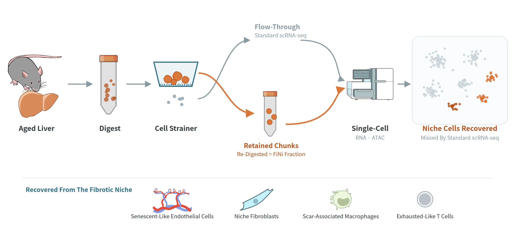
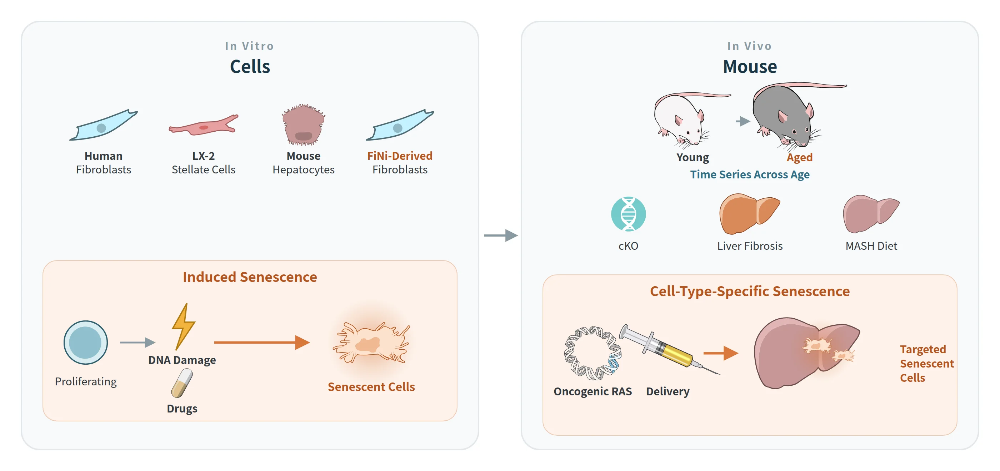

<!-- 문단·그림은 이 파일에 직접 씀. 카드(Data we generate 6, Functional assays 4)와 Key papers는 data/methods.yml.
     그림은 assets/methods/, 아이콘은 assets/methods/icons/. 그림은 본문 폭 (Research와 통일) -->

```{r}
#| include: false
source("R/site.R")
M <- yaml::read_yaml("data/methods.yml")
```

::: {.page-lead}
Our lab combines bioinformatics with wet-lab experiments.
:::

::: {.page-intro}
Working in cell and mouse models, we generate single-cell, spatial and long-read data in our own lab and add protein and metabolite measurements through collaborations. We analyze them mainly with established public packages, writing our own code where needed.
:::

[FiNi-seq](#fini-seq) · [Data we generate](#data-we-generate) · [Models](#models) · [Functional assays](#functional-assays) · [Computation](#computation)

## [Signature method]{.label-sm .kicker} FiNi-seq: Fibrotic Niche Enrichment Sequencing {#fini-seq .page-sec}

{fig-alt="FiNi-seq workflow: an aged liver is digested and passed through a cell strainer; the flow-through goes to standard scRNA-seq, while retained chunks are digested again as the FiNi fraction; both are profiled by single-cell RNA and ATAC sequencing, and the FiNi fraction recovers niche cells — senescent-like endothelial cells, niche fibroblasts, scar-associated macrophages and exhausted-like T cells."}

::: {.grid}

::: {.g-col-12 .g-col-md-7}
[How it works]{.label-sm}

Aged and fibrotic tissue resists enzymatic dissociation, so its niche cells stay on the cell strainer and are discarded in standard single-cell workflows. FiNi-seq collects these undissociated chunks, digests them again and profiles them by single-cell RNA and ATAC sequencing. In the aged mouse liver it recovers senescent-like endothelial cells, niche fibroblasts, scar-associated macrophages and exhausted-like T cells that standard scRNA-seq misses.
:::

::: {.g-col-12 .g-col-md-5}
[Key paper]{.label-sm}

```{r}
#| echo: false
#| results: asis
cat(paper_list(M$papers$fini))
```
:::

:::

## [Data layers]{.label-sm .kicker} Data we generate {#data-we-generate .page-sec}

```{r}
#| echo: false
#| results: asis
show_cards("data_cards", cols = 3)
```

## [Model systems]{.label-sm .kicker} Models {#models .page-sec}

{fig-alt="Model systems: in vitro, human fibroblasts, LX-2 stellate cells, mouse hepatocytes and FiNi-derived fibroblasts, with senescence induced by DNA damage or drugs; in vivo, young and aged mice, cKO, liver fibrosis and MASH diet models, and oncogenic RAS delivery to induce cell-type-specific senescence."}

::: {.grid}

::: {.g-col-12 .g-col-md-6}
**Cells**

- Human fibroblasts, LX-2 human hepatic stellate cells, primary mouse hepatocytes, and fibroblasts grown from FiNi-seq chunks
- Senescence induced in vitro by DNA damage or drugs
:::

::: {.g-col-12 .g-col-md-6}
**Mouse**

- Young and aged mice across age
- Conditional knockout (cKO) mice
- MASH diet and liver fibrosis models
- Oncogenic RAS delivery to induce cell-type-specific senescence
:::

:::

## [Perturb & validate]{.label-sm .kicker} Functional assays {#functional-assays .page-sec}

```{r}
#| echo: false
#| results: asis
show_cards("assay_cards", cols = 2)
```

## [Analysis]{.label-sm .kicker} Computation {#computation .page-sec}

::: {.grid}

::: {.g-col-12 .g-col-md-7}
::: {.mt-flex}
{.mt-icon fig-alt=""}

We analyze bulk, single-cell, spatial and long-read data in R and Python on in-house Ubuntu servers, using RStudio Server and Docker for reproducible environments, and reanalyze public aging atlases. We write our own code and tools where needed, with AI-assisted programming.
:::
:::

::: {.g-col-12 .g-col-md-5}
[Key papers]{.label-sm}

```{r}
#| echo: false
#| results: asis
cat(paper_list(M$papers$computation))
```
:::

:::

::: {.figure-credit}
Illustrations adapted from the NIAID NIH BIOART Source (public domain).
:::
