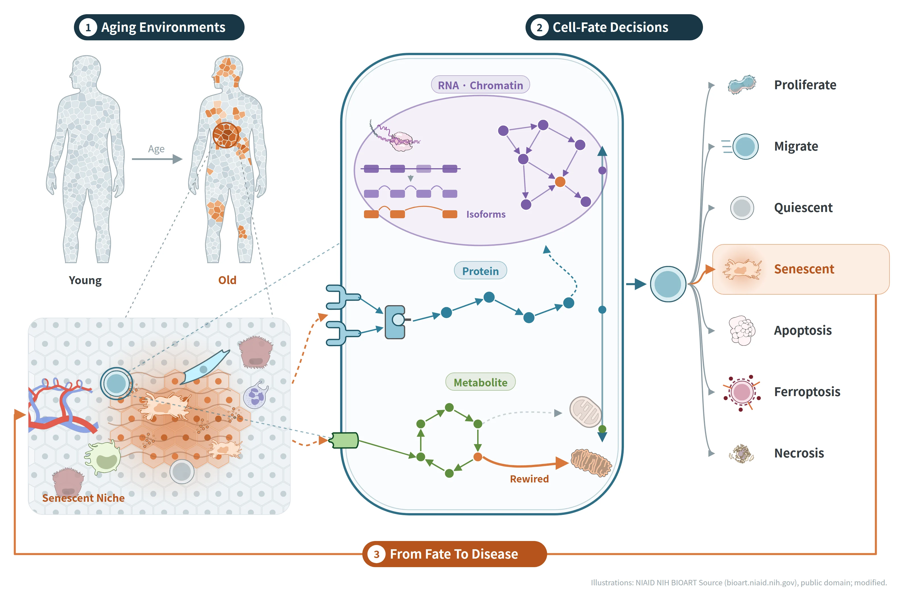

<!-- 세 주제(목차 카드·질문·그림·What we do·Key papers)는 data/projects.yml에서 자동 생성.
     그림은 assets/research/. 맨 아래 출처 문장은 그림에 쓴 NIAID BioArt 소재 표기 -->

<!-- 개요: 첫 문장은 리드(크고 굵게), 나머지는 보통 크기. 서식을 넣기 위해 description이 아닌 본문에 씀 -->
::: {.research-lead}
We study why tissues age unevenly.
:::

::: {.research-intro}
Damage that is never fully repaired leaves behind small aging niches, making aging a non-linear, mosaic process. We follow these niches, the cells that change fate inside them, and the diseases they lead to.
:::

{fig-alt="Overview of our research: human bodies become mosaic with age; zooming into an aged liver reveals a senescent niche; inside one cell of that niche, chromatin and RNA isoforms, protein signaling and metabolic rewiring lead to one of seven fates, and these fates feed back on the tissue."}

```{r}
#| echo: false
#| results: asis
source("R/site.R")
show_projects()
```

::: {.figure-credit}
Illustrations adapted from the NIAID NIH BIOART Source (public domain).
:::
